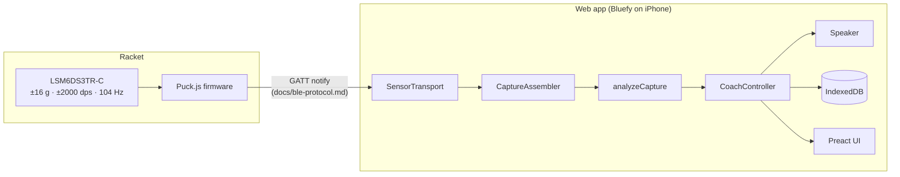

# Architecture

## Context

## Layers

Dependencies point inwards only. Everything left of the controller is pure and
has no knowledge of the browser.

| Layer | Modules | Responsibility | I/O |
| --- | --- | --- | --- |
| Domain | `domain/types.ts` | Data shapes: `RawCapture`, `ImuSeries`, `StrokeMetrics`, `Cue` | none |
| Math | `math/` | Vectors, rotation matrices, quaternions | none |
| Protocol | `protocol/` | Message codec, CRC-32, capture reassembly | none |
| Processing | `processing/` | Unit conversion, calibration, segmentation, attitude | none |
| Metrics | `metrics/analyzeSwing.ts` | Stroke metrics from one capture | none |
| Coaching | `coaching/` | Rule limits, correction texts, session statistics | none |
| Elements | `elements/` | Element catalogue and per-stroke assessment (population limits, personal band, Φ(d/σ)) | none |
| Coach | `coach/` | Personal baseline; player profile, deviation categories, fatigue detector; live coaching step (one focus per stroke type, phrase ladder, modes); training plan | none |
| Simulation | `simulation/` | Forward model of a swing; demo and tests | none |
| Adapters | `transport/`, `storage/`, `feedback/` | Web Bluetooth, simulated sensor, IndexedDB, Web Speech | yes |
| Application | `app/controller.ts` | Wires adapters to the pipeline; owns session state as signals | yes |
| UI | `ui/` | Views; read signals, call controller methods | DOM |

## Data flow for one stroke

1. **Firmware** keeps a 1.2 s ring buffer. A swing (‖ω‖ > 300 °/s, confirmed at
   700 °/s) opens a capture that streams the buffered and live samples as they
   are recorded and ends after ~150 ms below 100 °/s
   ([capture lifecycle](ble-protocol.md#capture-lifecycle)).
2. **`CaptureAssembler`** rebuilds the capture and validates index continuity,
   sample count and CRC-32. Corrupt captures are dropped and logged, never
   analysed.
3. **`analyzeCapture`**: counts → SI → racket frame → contact detection →
   attitude anchored in the quiet pre-swing phase → metrics and features →
   element assessment against population limits and the personal baseline
   (`assessStroke`).
4. **`CoachController`** assesses with the player's policy (level, style,
   hand), updates the fatigue detector, runs one `coachStep` (focus per
   stroke type, phrase ladder, overcorrection, mode), voices `step.speech`
   through the speech policy and queue (see [Speech](#speech); in match mode
   only a persistent major fault, from a timer once play pauses), adds the stroke to the personal baseline and
   the profile history, appends it to the session and persists the raw
   capture together with its metrics, the coaching outcome (with categories,
   mode, phrase level and fatigue flag) and the provenance needed to
   reproduce them (see [Persistence](#persistence)). Baseline and profile are
   loaded from the most recent stored strokes at session start
   ([coaching engine](metrics.md#coaching-engine),
   [adaptive coach](metrics.md#adaptive-coach)). The training plan is
   derived from the profile; an optional asynchronous `PlanEnhancer` hook is
   kept out of the stroke loop.

## Persistence

IndexedDB (`storage/repository.ts`), everything on the device. Stores:
`sessions`, `strokes` (indexes `bySession` and `byReceivedAt`, the latter on
`capture.receivedAt` for `recentStrokes(limit)`, the cross-session query the
personal baseline uses) and `kv` (per-device calibration, settings). Each
stroke also keeps its coaching outcome (`coach`: utterance kind, correction,
focus, and since the adaptive coach mode, deviation categories, phrase level
and fatigue flag; absent on older records). Settings (version 5) hold the
coaching mode, the player inputs and the speech settings (`feedbackFrequency`,
`voice` = { lang, voiceURI?, rate, pitch, volume }, `speechMuted`,
`autoRallyMute`; version 5 moved the old `speechRate` into `voice.rate`).

**Reproducibility.** Raw data is kept so strokes can be re-analysed, which only
works if the inputs are kept too. Every stroke record therefore stores, next to
`capture` and `metrics`:

- `analysisVersion`: `ANALYSIS_VERSION` in `metrics/version.ts`; bump it
  whenever analysis output changes;
- `analysisParams`: the exact `AnalysisParams` used (including the lever
  radius taken from settings);
- `calibration`: a snapshot of the `MountCalibration` in force.

The calibration is embedded in each stroke rather than kept in a history store
with ids: it is about a dozen numbers, so duplication is cheap, and it needs no
schema change, no cross-store consistency and no cleanup. Recalibration still
overwrites the per-device `kv` entry, which is only the *current* calibration.
Records saved before this existed lack the three fields; they load as they are
(a missing `analysisVersion` means "before versioning") and malformed values are
dropped on read. The JSON export (format version 2) carries all three per
stroke for offline re-analysis; the CSV has an `analysisVersion` column.

**Schema migrations.** `MIGRATIONS` is an ordered list of steps, each run only
if the stored version is older (`oldVersion < step.version`). Add a step for
every schema change, never edit an old one. The database version is the last
step's version: 2, which added the `byReceivedAt` index (the upgrade indexes
existing records; the fields above are optional properties, not schema).
`blocked` (another tab holds an older version) is logged; `blocking` closes this
tab's connection so the other tab's upgrade can proceed.

## Speech

The coach decides *what* to say; three layers decide whether and when it is
heard (`feedback/`):

1. **Policy** (`speechPolicy.ts`, applied in `CoachController.handleSwing`
   after `coachStep`): quick mute (`speechMuted`, `controller.toggleMute()`),
   automatic rally mute (`autoRallyMute`: ≥ 3 strokes < 3.5 s apart silence
   stroke cues until a ≥ 6 s pause; `RallyDetector`) and the feedback frequency
   (`FeedbackGate`): `every`, `changes` (a correction only when its text
   differs from the last one heard in the lane), `every2` / `every3` (at most
   one heard correction per 2 / 3 strokes), `off`. "Better", the reinforce
   phrase and system messages pass `changes` / `everyN`; mute and rally mute
   silence every stroke cue but never system messages. Match mode keeps its own
   policy (nothing per stroke, the break-time cue respects only mute).
2. **Text** (`spokenText.ts`, `speechStrings.ts`): the spoken language is
   `voice.lang`, but Estonian only when the device has an Estonian voice
   (iOS may have none; the settings then show "Eestikeelset häält pole selles
   seadmes — kasutan inglise keelt"). Estonian cue texts come through a
   tolerant adapter (`spokenEt` on a correction, `FEEDBACK_PHRASES_ET`); a
   phrase without Estonian text is spoken in English with an English voice.
   System messages (sensor connected / disconnected / lost / battery low)
   exist in both languages.
3. **Queue** (`SpeechQueue` in `speech.ts`, Web Speech): one utterance at a
   time, never the engine's own queue; priorities system > correction >
   feedback > info; at most one queued item per category; a new stroke's item
   replaces queued older stroke items (and the controller drops not-yet-started
   stroke items when the next stroke arrives); an item older than
   `maxAgeMs` (2.5 s from the stroke's `receivedAt`) when it would start is
   dropped; a speaking item is cut only after its minimum (`minSpeakMs`: a
   3-word cue finishes), only by a newer stroke's item or a system message,
   and a system message only by another system message. WebKit quirks: a
   paused engine is resumed before speaking, leftovers are cancelled, a missing
   `onstart` (1.5 s) triggers cancel + resume and one retry, a missing `onend`
   (watchdog from the phrase length) cancel + resume. Late events of
   utterances given up on are ignored. The voice object is cached per
   language/voice; `prime()` runs on the connect tap.

**Heard truth.** The coach builds on heard cues only ("Better" and the
reinforce phrase need a heard cue; the ladder advances per heard cue). A cue
the policy suppresses is decided again with `coachStep(…, speaking = false)`
before the state is committed. A cue the queue drops (`onDrop`) rolls the
state back to that unheard decision when nothing happened since; otherwise
`withCueUnheard` clears the focus' `lastHeardLevel`. `FeedbackGate` and
`lastSpeech` learn from `onStart` only.

**Diagnostics.** `controller.speechStats`: stroke-to-`onstart` latency per
cue with p50 / p95, drops by reason and suppressions by reason, reset per
session; shown under Settings → Speech.

## Latency budget (target ≤ 1 s from contact to speech)

| Stage | Typical |
| --- | --- |
| Follow-through until the capture closes | 0.3–0.6 s |
| Remaining BLE transfer (streaming overlaps the swing) | < 0.2 s |
| Analysis | < 5 ms |
| Speech start | 0.1–0.3 s |

This is fast enough between fed balls; in rallies the cue would overlap the
next shot, hence the **match** mode, silent per stroke and speaking only
between points, and the automatic rally mute. The measured stroke-to-speech
latency is in `speechStats` (p50 / p95).

## Testing strategy

- **Unit tests** for math, codec, CRC, calibration, rules, statistics, export,
  element assessment, baseline, profile, categories, fatigue, plan and the
  coach (including simulated-stroke tests and step-table scenario tests in
  `app/test/coach/scenarios.test.ts`: stroke → what is said).
- **Simulation tests**: `simulateSwing` produces sensor data from a known
  stroke geometry (face, path, speed, mounting); `analyzeSwing` must recover it,
  including with sensor noise, an arbitrarily rotated sensor, backhands,
  overheads, early acceleration, misses and gyro saturation.
- **Firmware-in-the-loop**: the Espruino source runs on Node with fakes of
  `NRF`, `Puck` and `E`; its notifications go through the app's assembler and
  analysis. This also enforces the protocol constants on both sides.
- **Controller end-to-end** with the simulated transport: connect,
  calibrate over the wire, analyse, speak, persist.
- **Speech**: `SpeechQueue` against a fake `speechSynthesis` with WebKit's
  quirks (`app/test/feedback/fakeSpeech.ts`: start/end events, stuck `onstart`,
  missing `onend`, paused engine, voices); controller speech policy with a
  scripted speaker (`app/test/app/speechController.test.ts`).
- **Hardware geometry** tests for both mounts (watertight, fits, validates input).

Real recorded strokes become fixtures in `app/test/fixtures` once hardware is
available ([bring-up](bring-up.md)).
