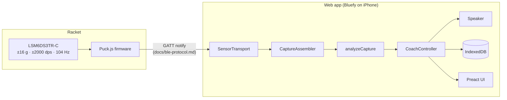

# Architecture

## Context

## Layers

Dependencies point inwards only. Everything left of the controller is pure and
has no knowledge of the browser.

| Layer | Modules | Responsibility | I/O |
| --- | --- | --- | --- |
| Domain | `domain/types.ts` | Data shapes: `RawCapture`, `ImuSeries`, `StrokeMetrics`, `Cue` | none |
| Math | `math/` | Vectors, rotation matrices, quaternions | none |
| Protocol | `protocol/` | Message codec, CRC-32, capture reassembly | none |
| Processing | `processing/` | Unit conversion, calibration, segmentation, attitude | none |
| Metrics | `metrics/analyzeSwing.ts` | Stroke metrics from one capture | none |
| Coaching | `coaching/` | Rule engine, default rules, session statistics | none |
| Simulation | `simulation/` | Forward model of a swing; demo and tests | none |
| Adapters | `transport/`, `storage/`, `feedback/` | Web Bluetooth, simulated sensor, IndexedDB, Web Speech | yes |
| Application | `app/controller.ts` | Wires adapters to the pipeline; owns session state as signals | yes |
| UI | `ui/` | Views; read signals, call controller methods | DOM |

## Data flow for one stroke

1. **Firmware** keeps a 1.2 s ring buffer. A swing (‖ω‖ > 300 °/s, confirmed at
   700 °/s) opens a capture that streams the buffered and live samples as they
   are recorded and ends after ~150 ms below 100 °/s
   ([capture lifecycle](ble-protocol.md#capture-lifecycle)).
2. **`CaptureAssembler`** rebuilds the capture and validates index continuity,
   sample count and CRC-32. Corrupt captures are dropped and logged, never
   analysed.
3. **`analyzeCapture`**: counts → SI → racket frame → contact detection →
   attitude anchored in the quiet pre-swing phase → metrics → one cue.
4. **`CoachController`** voices the cue (drill mode), appends the stroke to the
   session and persists the raw capture together with its metrics and the
   provenance needed to reproduce them (see [Persistence](#persistence)).

## Persistence

IndexedDB (`storage/repository.ts`), everything on the device. Stores:
`sessions`, `strokes` (index `bySession`) and `kv` (per-device calibration,
settings).

**Reproducibility.** Raw data is kept so strokes can be re-analysed, which only
works if the inputs are kept too. Every stroke record therefore stores, next to
`capture` and `metrics`:

- `analysisVersion`: `ANALYSIS_VERSION` in `metrics/version.ts`; bump it
  whenever analysis output changes;
- `analysisParams`: the exact `AnalysisParams` used (including the lever
  radius taken from settings);
- `calibration`: a snapshot of the `MountCalibration` in force.

The calibration is embedded in each stroke rather than kept in a history store
with ids: it is about a dozen numbers, so duplication is cheap, and it needs no
schema change, no cross-store consistency and no cleanup. Recalibration still
overwrites the per-device `kv` entry, which is only the *current* calibration.
Records saved before this existed lack the three fields; they load as they are
(a missing `analysisVersion` means "before versioning") and malformed values are
dropped on read. The JSON export (format version 2) carries all three per
stroke for offline re-analysis; the CSV has an `analysisVersion` column.

**Schema migrations.** `MIGRATIONS` is an ordered list of steps, each run only
if the stored version is older (`oldVersion < step.version`). Add a step for
every schema change, never edit an old one. The database version is the last
step's version (still 1: the fields above are optional properties, not schema).
`blocked` (another tab holds an older version) is logged; `blocking` closes this
tab's connection so the other tab's upgrade can proceed.

## Latency budget (target ≤ 1 s from contact to speech)

| Stage | Typical |
| --- | --- |
| Follow-through until the capture closes | 0.3–0.6 s |
| Remaining BLE transfer (streaming overlaps the swing) | < 0.2 s |
| Analysis | < 5 ms |
| Speech start | 0.1–0.3 s |

This is fast enough between fed balls; in rallies the cue would overlap the
next shot, hence the silent **rally** mode.

## Testing strategy

- **Unit tests** for math, codec, CRC, calibration, rules, statistics, export.
- **Simulation tests**: `simulateSwing` produces sensor data from a known
  stroke geometry (face, path, speed, mounting); `analyzeSwing` must recover it,
  including with sensor noise, an arbitrarily rotated sensor, backhands,
  overheads, early acceleration, misses and gyro saturation.
- **Firmware-in-the-loop**: the Espruino source runs on Node with fakes of
  `NRF`, `Puck` and `E`; its notifications go through the app's assembler and
  analysis. This also enforces the protocol constants on both sides.
- **Controller end-to-end** with the simulated transport: connect,
  calibrate over the wire, analyse, speak, persist.
- **Hardware geometry** tests for both mounts (watertight, fits, validates input).

Real recorded strokes become fixtures in `app/test/fixtures` once hardware is
available ([bring-up](bring-up.md)).
