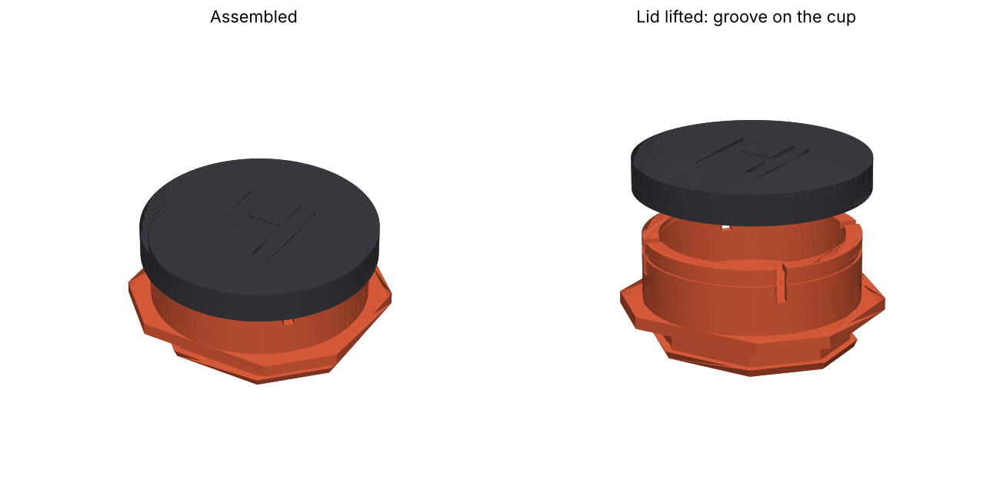

# Butt cap for Puck.js (recommended mount)

Replaces the stock butt cap. The racket side copies the stock Wilson Blade cap
(flange plus octagonal collar with a tapered rim at its tip), so it mounts like the
original; the outside carries a cup for the bare Puck.js PCB.



| | |
| --- | --- |
| Footprint | 35 × 32 mm flange; the cup (31.8 mm) never extends past it or the grip |
| Added length | ≈ 12 mm |
| Mass | ≈ 5 g printed + 7 g PCB with coin cell |
| Lid | Snap-on, 34.7 mm, engraved "H"; clicks into a groove on the cup |
| Material | PETG, 100 % infill, printed as exported (no supports) |

Why here and not on the strings: no change to string-bed feel, much smaller
impact shocks for the coin cell, a mount as strong as the original cap, and a
balance shift towards the handle rather than the head. The trade-off is that
contact location on the string bed cannot be estimated from the handle.

## Workflow

1. Print `--fit-test` (racket side only, ~10 min). Check it seats in the handle
   like the stock cap: tight, no wobble.
2. Adjust parameters if needed and print the full cap:

```sh
pip install -r requirements.txt
python buttcap.py --fit-test --rim-inset 0.8   # smaller rim: looser fit
python buttcap.py --collar-width 30.2 --collar-length 26.1
pytest -q
```

3. Take the bare PCB out of the Puck case and snap it (coin cell towards the
   racket) into the cup past the fingers. Push the lid on until it clicks; the
   cup fingers flex inwards to let the bead pass. Fit the cap like the
   original (the stock staples, or re-wrap the grip over the flange).
   `out/buttcap-with-lid.3mf` has both parts on one plate.
4. Re-run calibration in the app.

Default dimensions were read from photos of a Wilson Blade cap against a ruler
(±0.5 mm). Other racket models need their own measurements; every dimension is
a parameter in `ButtCapParams`.
