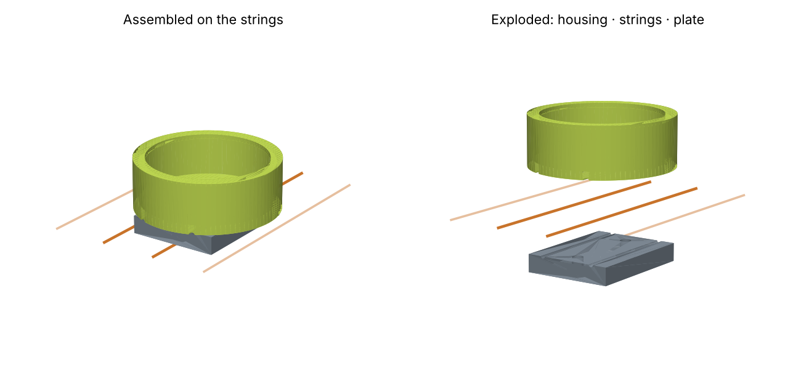

# String-bed clamp for Puck.js (alternative mount)

The [butt cap](../buttcap) is the recommended mount. Use this clamp when
contact location on the string bed matters more than feel.

Two printed parts clamp the two centre main strings between them, in the place
of a vibration dampener (between the throat bridge and the first cross string).



| Part | Material | Print orientation |
| --- | --- | --- |
| `puck-clamp-top-*.3mf` — housing | TPU 95A, 100 % infill | lip down (as exported) |
| `puck-clamp-bottom-*.3mf` — backing plate | PETG, 100 % infill | nut pockets down (as exported) |

Hardware: 2 × **M2×6 countersunk** screws (ISO 10642 / DIN 7991) and 2 × **M2 hex
nuts**. Approximate mass with the Puck PCB and coin cell: 13 g (housing 32 × 11.4 mm, smaller than the stock Puck case of 36 × 12.5 mm).

Bambu Lab: feed TPU from an external spool, not through the AMS.

## Why a screw clamp

A snap-on clip only grips the strings with the elasticity of TPU; the string
bed sees peak accelerations of hundreds of g at ball impact, so a clip shakes
loose. Clamping the strings between two rigid faces holds by friction under
screw preload and cannot come off unless the screws are undone.

## Generate for your racket

Measure with calipers near the throat:

- `--main-spacing`: centre-to-centre distance of the two centre main strings
- `--string-gauge`: string diameter (on the string packet, e.g. 1.25)

```sh
pip install -r requirements.txt
python clip.py --main-spacing 12.6 --string-gauge 1.25
pytest -q
```

Files are written to `out/`. CI builds the default parts on every push
(artifact `clip-models`).

## Assembly

The screw heads sit under the PCB, so clamp first and insert the PCB last.

1. Put the nuts into the pockets of the backing plate.
2. Hold the empty housing on the forehand face and the plate on the other face,
   with the grooves on the two centre mains; the screws pass between the strings.
3. Tighten until the two parts just touch. Do not over-tighten TPU.
4. Push the Puck PCB, coin cell down, into the housing past the lip.
5. Re-run the calibration in the app after every re-mount.

To re-tighten later, take the PCB out first.

All dimensions are parameters in `ClipParams` (`clip.py`).
